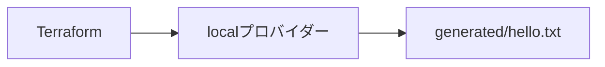

# 基礎1・2：ローカルファイルとstate

[基礎の5実習へ](../README.md) · [全体の入口](../../../README.md)

## 目的

実習1でファイルを作り、実習2で内容の変更とstateを学びます。

## 構成図



## 作る

手順は [基礎の実習1・2](../README.md#実習1ファイルを作る) にまとまっています。
まず [main.tf](main.tf) を読みます。[providers.tf](providers.tf) は接続とバージョン設定です。
基礎では一つの短い設定を発展させるため、変数と出力もmain.tfにまとめています。

## 確認する

作成したファイルの内容と、変更後の No changes. を確認します。

## 一か所変更する

実習2でmain.tfのcontentを変更します。

## 片付ける

```sh
mise run lesson:cleanup -- 01-basics/01-local-files
```

実習5では [両方の削除・再作成](../README.md#実習5削除してもう一度作る) を手動でも体験します。
