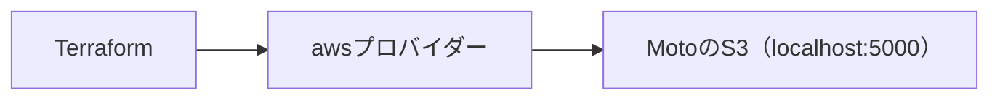

# 基礎3・4：S3と変数

[基礎の5実習へ](../README.md) · [全体の入口](../../../README.md)

## 目的

実習3でMotoのS3に保存し、実習4で変数から複数のファイルを作ります。

## 構成図



## 作る

手順は [基礎の実習3・4](../README.md#実習3ローカルのs3にファイルを保存する) にまとまっています。
まず [main.tf](main.tf) を読みます。[providers.tf](providers.tf) は接続とバージョン設定です。
基礎では一つの短い設定を発展させるため、変数と出力もmain.tfにまとめています。

## 確認する

AWS CLIでファイルを取得し、変数を渡すと追加の2ファイルが作られることを確認します。

## 一か所変更する

実習4でlesson4.auto.tfvarsのファイル名と内容を変更します。

## 片付ける

```sh
mise run lesson:cleanup -- 01-basics/02-s3-storage
```

実習5では [両方の削除・再作成](../README.md#実習5削除してもう一度作る) を手動でも体験します。
