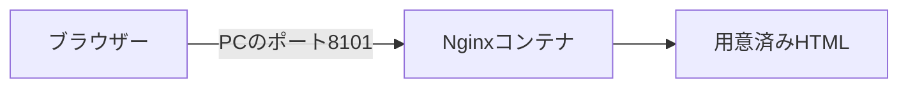

# Docker 1：静的サイト

[全体の入口](../../../README.md) · 前：[前の教材](../../01-basics/README.md) · 次：[次の教材](../02-web-database/README.md)

## 目的

TerraformからWebサーバーを1つ起動し、ブラウザーにページが届くまでを確かめます。

前提：[準備](../../../docs/guides/setup.md)と、それまでの教材を終えていること。アプリのコードを編集する必要はありません。

## 構成図



`ports` の `internal` はコンテナ内、`external` はPC側の入口です。`ip = "127.0.0.1"` でこのPC内だけに公開しています。

この教材のコンテナ・ネットワーク・ボリュームはTerraformが管理します。

## 作る

READMEがあるプロジェクトのルートで実行します。

```sh
mise run lesson:prepare -- 02-docker-systems/01-static-site
mise run lesson:plan -- 02-docker-systems/01-static-site
mise run lesson:apply -- 02-docker-systems/01-static-site
```

`prepare` は初期化を行います。
`plan` で予定を確認し、`apply` の確認には `yes` と入力してください。
初回はイメージのダウンロードやビルドに時間がかかります。
最後に表示される `web_url` がブラウザーで開くURLです。

読む順番は [main.tf](main.tf) → [variables.tf](variables.tf) → [outputs.tf](outputs.tf) です。
[providers.tf](providers.tf) は接続先・バージョンの設定で、最初は編集不要です。

## 確認する

ブラウザーで **http://127.0.0.1:8101** を開きます。

「Terraformから、Webサーバーが動きました。」と表示されれば成功です。

```sh
mise run lesson:status -- 02-docker-systems/01-static-site
mise run lesson:plan -- 02-docker-systems/01-static-site
```

ブラウザーからデータを変えても、インフラ構成を変えていなければ `No changes.` になります。
Terraformは保存データの1件ずつを管理しているわけではありません。

## 一か所変更する

この教材フォルダに `practice.auto.tfvars` を作り、次の入力値を書きます。

```hcl
welcome = "はじめてのWebサーバー、"
```

```sh
mise run lesson:plan -- 02-docker-systems/01-static-site
mise run lesson:apply -- 02-docker-systems/01-static-site
```

設定の差分を確認して適用し、ブラウザーを再読み込みします。見出しやタイトルが変われば成功です。
コンテナは置き換えになる場合があります。

## 片付ける

```sh
mise run lesson:cleanup -- 02-docker-systems/01-static-site
```

確認入力なしで、この教材のコンテナ・専用ネットワーク・専用ボリュームと実習データを削除します。
編集した入力値とイメージは残ります。`lesson:status` で管理対象とコンテナの一覧が空であることを確認できます。

DBとRedisのデータはコンテナの再起動では残りますが、教材のcleanupではボリュームごと削除します。


[困ったとき](../../../docs/guides/troubleshooting.md) · [片付け・再開の詳しい説明](../../../docs/guides/cleanup.md)
