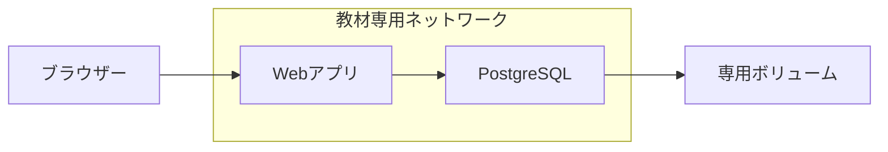

# Docker 2：Webとデータベース

[全体の入口](../../../README.md) · 前：[前の教材](../01-static-site/README.md) · 次：[次の教材](../03-background-jobs/README.md)

## 目的

メモを保存するWebアプリとPostgreSQLをつなぎ、コンテナとデータ保存先の違いを確かめます。

前提：[準備](../../../docs/guides/setup.md)と、それまでの教材を終えていること。アプリのコードを編集する必要はありません。

## 構成図



WebだけにPC側のポートを割り当てます。DBには内部の名前 `db` で接続し、DBのデータは専用ボリュームに保存します。`depends_on` とヘルスチェックでDBの準備を待ちます。

この教材のコンテナ・ネットワーク・ボリュームはTerraformが管理します。

## 作る

READMEがあるプロジェクトのルートで実行します。

```sh
mise run lesson:prepare -- 02-docker-systems/02-web-database
mise run lesson:plan -- 02-docker-systems/02-web-database
mise run lesson:apply -- 02-docker-systems/02-web-database
```

`prepare` は初期化、デモアプリのビルドを行います。
`plan` で予定を確認し、`apply` の確認には `yes` と入力してください。
初回はイメージのダウンロードやビルドに時間がかかります。
最後に表示される `web_url` がブラウザーで開くURLです。

読む順番は [main.tf](main.tf) → [variables.tf](variables.tf) → [outputs.tf](outputs.tf) です。
[providers.tf](providers.tf) は接続先・バージョンの設定で、最初は編集不要です。

## 確認する

ブラウザーで **http://127.0.0.1:8102** を開きます。

1. ブラウザーでメモを2つ保存します。
2. 一覧を更新し、保存した内容を確認します。
3. 1つ削除し、残り1つだけになることを確認します。

```sh
mise run lesson:status -- 02-docker-systems/02-web-database
mise run lesson:plan -- 02-docker-systems/02-web-database
```

ブラウザーからデータを変えても、インフラ構成を変えていなければ `No changes.` になります。
Terraformは保存データの1件ずつを管理しているわけではありません。

### DBを再起動しても残るか

```sh
docker restart terraform-playground-d02-db
```

数秒待ってブラウザーの一覧を更新します。メモが残るのは、コンテナとは別のボリュームに保存しているためです。

## 一か所変更する

この教材フォルダに `practice.auto.tfvars` を作り、次の入力値を書きます。

```hcl
app_title = "自分のメモ管理サービス"
```

```sh
mise run lesson:plan -- 02-docker-systems/02-web-database
mise run lesson:apply -- 02-docker-systems/02-web-database
```

設定の差分を確認して適用し、ブラウザーを再読み込みします。見出しやタイトルが変われば成功です。
コンテナは置き換えになる場合がありますが、専用ボリュームのメモは残ります。

## 片付ける

```sh
mise run lesson:cleanup -- 02-docker-systems/02-web-database
```

確認入力なしで、この教材のコンテナ・専用ネットワーク・専用ボリュームと実習データを削除します。
編集した入力値とイメージは残ります。`lesson:status` で管理対象とコンテナの一覧が空であることを確認できます。

DBとRedisのデータはコンテナの再起動では残りますが、教材のcleanupではボリュームごと削除します。


[困ったとき](../../../docs/guides/troubleshooting.md) · [片付け・再開の詳しい説明](../../../docs/guides/cleanup.md)
