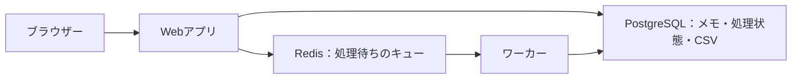

# Docker 3：バックグラウンド処理

[全体の入口](../../../README.md) · 前：[前の教材](../02-web-database/README.md) · 次：[次の教材](../../03-aws-systems/01-object-storage/README.md)

## 目的

Webリクエストの中で処理を終える構成から、キューで受け付けて別のワーカーで実行する構成へ進みます。

前提：[準備](../../../docs/guides/setup.md)と、それまでの教材を終えていること。アプリのコードを編集する必要はありません。

## 構成図



Webはジョブを受け付け、Redisに処理のIDを渡します。ワーカーがCSVを作り、結果と状態をPostgreSQLへ保存します。利用者は完了後にダウンロードします。

この教材のコンテナ・ネットワーク・ボリュームはTerraformが管理します。

## 作る

READMEがあるプロジェクトのルートで実行します。

```sh
mise run lesson:prepare -- 02-docker-systems/03-background-jobs
mise run lesson:plan -- 02-docker-systems/03-background-jobs
mise run lesson:apply -- 02-docker-systems/03-background-jobs
```

`prepare` は初期化、デモアプリのビルドを行います。
`plan` で予定を確認し、`apply` の確認には `yes` と入力してください。
初回はイメージのダウンロードやビルドに時間がかかります。
最後に表示される `web_url` がブラウザーで開くURLです。

読む順番は [main.tf](main.tf) → [variables.tf](variables.tf) → [outputs.tf](outputs.tf) です。
[providers.tf](providers.tf) は接続先・バージョンの設定で、最初は編集不要です。

## 確認する

ブラウザーで **http://127.0.0.1:8103** を開きます。

1. メモを保存します。
2. 「一覧をCSVに出力」を押します。
3. 「受付済み → 処理中 → 完了」と進み、CSVを取得できれば成功です。短い処理では途中の状態が見えない場合があります。

```sh
mise run lesson:status -- 02-docker-systems/03-background-jobs
mise run lesson:plan -- 02-docker-systems/03-background-jobs
```

ブラウザーからデータを変えても、インフラ構成を変えていなければ `No changes.` になります。
Terraformは保存データの1件ずつを管理しているわけではありません。

### ワーカーを止めて「受付と実行」の違いを見る

```sh
docker stop terraform-playground-d03-worker
```

もう一度CSV出力を依頼すると、「受付済み」で待ちます。Webは動き続けます。

```sh
docker start terraform-playground-d03-worker
```

再開後に完了へ進めば成功です。コンテナ名は標準設定の場合のものです。

## 一か所変更する

この教材フォルダに `practice.auto.tfvars` を作り、次の入力値を書きます。

```hcl
app_title = "バックグラウンド処理の実習"
```

```sh
mise run lesson:plan -- 02-docker-systems/03-background-jobs
mise run lesson:apply -- 02-docker-systems/03-background-jobs
```

設定の差分を確認して適用し、ブラウザーを再読み込みします。見出しやタイトルが変われば成功です。
コンテナは置き換えになる場合がありますが、専用ボリュームのメモは残ります。

## 片付ける

```sh
mise run lesson:cleanup -- 02-docker-systems/03-background-jobs
```

確認入力なしで、この教材のコンテナ・専用ネットワーク・専用ボリュームと実習データを削除します。
編集した入力値とイメージは残ります。`lesson:status` で管理対象とコンテナの一覧が空であることを確認できます。

DBとRedisのデータはコンテナの再起動では残りますが、教材のcleanupではボリュームごと削除します。

このRedisの例は単純なリストを使います。処理中の強制終了後の再配信や厳密な一度だけの実行は保証しません。SQS編で再配信への備えを学びます。


[困ったとき](../../../docs/guides/troubleshooting.md) · [片付け・再開の詳しい説明](../../../docs/guides/cleanup.md)
