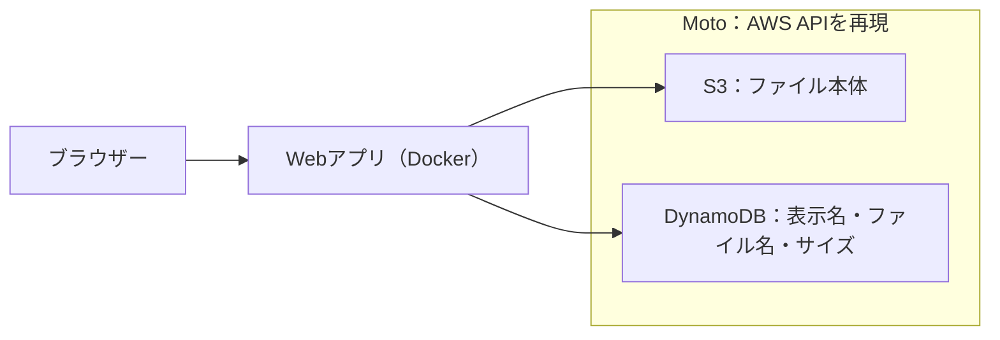

# AWS 2：ファイルとメタデータ

[全体の入口](../../../README.md) · 前：[前の教材](../01-object-storage/README.md) · 次：[次の教材](../03-queue-worker/README.md)

## 目的

ファイル本体と、そのファイルの表示名などの情報を別の保存先に分けます。

前提：[準備](../../../docs/guides/setup.md)と、それまでの教材を終えていること。アプリのコードを編集する必要はありません。

## 構成図



S3にはファイル本体、DynamoDBにはファイルのID・表示名・サイズを保存します。SQLのPostgreSQLと、キーでデータを扱うDynamoDBの違いを比べます。

Motoはエミュレーターであり、実AWSのサービスは使いません。Moto用のCompose設定は補助環境として起動し、WebアプリとAWS風リソースをTerraformで作ります。

## 作る

READMEがあるプロジェクトのルートで実行します。

```sh
mise run lesson:prepare -- 03-aws-systems/02-database-storage
mise run lesson:plan -- 03-aws-systems/02-database-storage
mise run lesson:apply -- 03-aws-systems/02-database-storage
```

`prepare` は初期化、専用Motoの起動、デモアプリのビルドを行います。
`plan` で予定を確認し、`apply` の確認には `yes` と入力してください。
初回はイメージのダウンロードやビルドに時間がかかります。
最後に表示される `web_url` がブラウザーで開くURLです。

読む順番は [main.tf](main.tf) → [variables.tf](variables.tf) → [outputs.tf](outputs.tf) です。
[providers.tf](providers.tf) は接続先・バージョンの設定で、最初は編集不要です。

## 確認する

ブラウザーで **http://127.0.0.1:8202** を開きます。

1. ファイルと表示名（例：学習の記録）を入力して保存します。
2. 一覧に表示名と元のファイル名が出ることを確認します。
3. 取得すると内容が元通りであること、削除すると一覧から消えることを確認します。

```sh
mise run lesson:status -- 03-aws-systems/02-database-storage
mise run lesson:plan -- 03-aws-systems/02-database-storage
```

ブラウザーからデータを変えても、インフラ構成を変えていなければ `No changes.` になります。
Terraformは保存データの1件ずつを管理しているわけではありません。

## 一か所変更する

この教材フォルダに `practice.auto.tfvars` を作り、次の入力値を書きます。

```hcl
app_title = "ファイルとメタデータの実習"
```

```sh
mise run lesson:plan -- 03-aws-systems/02-database-storage
mise run lesson:apply -- 03-aws-systems/02-database-storage
```

設定の差分を確認して適用し、ブラウザーを再読み込みします。見出しやタイトルが変われば成功です。
コンテナは置き換えになる場合があります。

## 片付ける

```sh
mise run lesson:cleanup -- 03-aws-systems/02-database-storage
```

確認入力なしで、この教材のアップロードしたファイルやCSVを含む実習データ、Web・ワーカー、Motoを削除します。
編集した入力値とイメージは残ります。`lesson:status` で管理対象とコンテナの一覧が空であることを確認できます。

**Motoの停止・再起動だけでも、エミュレーター内のデータは消えます。** stateはPCに残るので、必要なリソースを作り直すには prepare → plan → apply と進めます。実AWSの永続性や権限、可用性はこの教材では再現しません。


[困ったとき](../../../docs/guides/troubleshooting.md) · [片付け・再開の詳しい説明](../../../docs/guides/cleanup.md)
