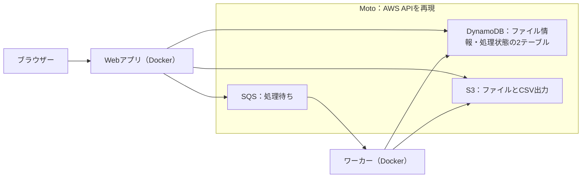

# AWS 3：キューとワーカー

[全体の入口](../../../README.md) · 前：[前の教材](../02-database-storage/README.md) · 次：[次の教材](../../../docs/guides/cleanup.md)

## 目的

SQSで処理を受け付け、別のワーカーがファイル一覧のCSVを生成します。Docker編のRedisと役割を比較します。

前提：[準備](../../../docs/guides/setup.md)と、それまでの教材を終えていること。アプリのコードを編集する必要はありません。

## 構成図



ワーカーはメッセージを受け取り、CSVをS3へ保存してからメッセージを削除します。同じジョブが再配信されても、完成済みの結果を再作成せずに終了します。

Motoはエミュレーターであり、実AWSのサービスは使いません。Moto用のCompose設定は補助環境として起動し、WebアプリとAWS風リソースをTerraformで作ります。

## 作る

READMEがあるプロジェクトのルートで実行します。

```sh
mise run lesson:prepare -- 03-aws-systems/03-queue-worker
mise run lesson:plan -- 03-aws-systems/03-queue-worker
mise run lesson:apply -- 03-aws-systems/03-queue-worker
```

`prepare` は初期化、専用Motoの起動、デモアプリのビルドを行います。
`plan` で予定を確認し、`apply` の確認には `yes` と入力してください。
初回はイメージのダウンロードやビルドに時間がかかります。
最後に表示される `web_url` がブラウザーで開くURLです。

読む順番は [main.tf](main.tf) → [variables.tf](variables.tf) → [outputs.tf](outputs.tf) です。
[providers.tf](providers.tf) は接続先・バージョンの設定で、最初は編集不要です。

## 確認する

ブラウザーで **http://127.0.0.1:8203** を開きます。

1. ファイルを1つ以上保存します。
2. 「一覧をCSVに出力」を押します。
3. 完了後にCSVを取得し、ファイル名と表示名が入っていれば成功です。

```sh
mise run lesson:status -- 03-aws-systems/03-queue-worker
mise run lesson:plan -- 03-aws-systems/03-queue-worker
```

ブラウザーからデータを変えても、インフラ構成を変えていなければ `No changes.` になります。
Terraformは保存データの1件ずつを管理しているわけではありません。

### ワーカーを止めて「受付と実行」の違いを見る

```sh
docker stop terraform-playground-a03-worker
```

もう一度CSV出力を依頼すると、「受付済み」で待ちます。Webは動き続けます。

```sh
docker start terraform-playground-a03-worker
```

再開後に完了へ進めば成功です。コンテナ名は標準設定の場合のものです。

## 一か所変更する

この教材フォルダに `practice.auto.tfvars` を作り、次の入力値を書きます。

```hcl
app_title = "SQSで処理するファイル管理"
```

```sh
mise run lesson:plan -- 03-aws-systems/03-queue-worker
mise run lesson:apply -- 03-aws-systems/03-queue-worker
```

設定の差分を確認して適用し、ブラウザーを再読み込みします。見出しやタイトルが変われば成功です。
コンテナは置き換えになる場合があります。

## 片付ける

```sh
mise run lesson:cleanup -- 03-aws-systems/03-queue-worker
```

確認入力なしで、この教材のアップロードしたファイルやCSVを含む実習データ、Web・ワーカー、Motoを削除します。
編集した入力値とイメージは残ります。`lesson:status` で管理対象とコンテナの一覧が空であることを確認できます。

**Motoの停止・再起動だけでも、エミュレーター内のデータは消えます。** stateはPCに残るので、必要なリソースを作り直すには prepare → plan → apply と進めます。実AWSの永続性や権限、可用性はこの教材では再現しません。


SQSの重複配信を考え、ジョブIDを結果のキーに使います。ワーカーは1つで動かす教材です。複数ワーカーでの排他制御や本番の運用設計は対象外です。

[困ったとき](../../../docs/guides/troubleshooting.md) · [片付け・再開の詳しい説明](../../../docs/guides/cleanup.md)
